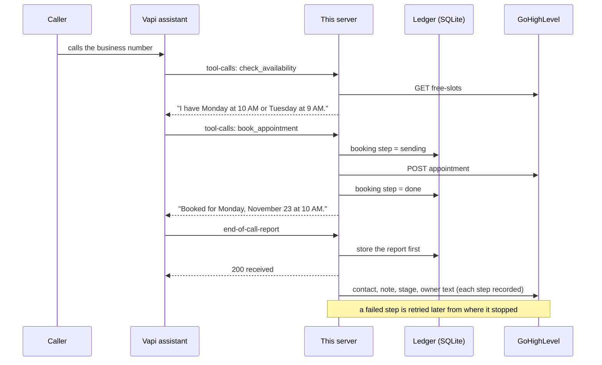

# Voice receptionist on GoHighLevel (Vapi + GHL)

An AI phone receptionist for a service business: it answers every call, books jobs into a GoHighLevel
calendar while the caller is on the line, transfers emergencies to a person, and puts every call into
GHL afterwards, with the transcript, recording, pipeline stage, and a text to the owner.

The interesting part is what happens when something fails. A dropped webhook, a GHL timeout, or a
retry that writes twice should never turn a caller into a lost lead without anyone noticing. Most of
the code and tests are about that.

> **Status: reference build.** It is written against Vapi's and HighLevel's documented API contracts
> and tested offline (37 tests) against recorded-shape Vapi payloads and an in-memory GHL that
> injects failures. It is not running for a client, and it has not been pointed at a live Vapi
> account yet. [What isn't verified](#what-isnt-verified-yet) lists the gaps.

## What each client gets

| Piece | How it's built | Where |
|---|---|---|
| Voice receptionist with a knowledge base | Vapi assistant rendered from one shared template plus a per-client facts file | [assistant/](assistant/), [clients/](clients/) |
| Emergency transfer | Vapi `transferCall` tool; the prompt sends emergencies straight to it | [assistant/template.json](assistant/template.json) |
| Live booking on the call | Two Vapi tools backed by GHL's free-slots and appointments endpoints | [receptionist/tools.py](receptionist/tools.py) |
| Post-call sync | End-of-call report → GHL contact, note (summary, transcript, recording), pipeline stage, owner text | [receptionist/sync.py](receptionist/sync.py) |
| Missed-call and web-lead text-back, 24 h and 1 h reminders | GHL workflows | [docs/ghl-workflows.md](docs/ghl-workflows.md) |
| The same sync in Make.com | Scenario design with error routes | [docs/make-scenario.md](docs/make-scenario.md) |
| Go-live checks | Scripted test calls, each passed on what GHL stored | [docs/go-live-tests.md](docs/go-live-tests.md) |

## How a call flows



## Failure handling

Every rule below has a test that checks GHL's stored state, not the code's return value, and each
of the three idempotency guards was broken on purpose to confirm its test fails.

| What goes wrong | What happens | Test |
|---|---|---|
| Vapi delivers the same report twice | The second copy is ignored; one note, one owner text | `test_same_report_delivered_twice_writes_once` |
| GHL rate-limits (429) or returns 5xx | Retried in the same pass with backoff, honoring `Retry-After` | `test_rate_limit_is_retried_inside_the_pass` |
| GHL stays down past the in-pass retries | Event marked `failed`; the retry job resumes at the failed step, finished steps are not repeated | `test_partial_failure_resumes_without_repeating_finished_steps` |
| A note write times out after GHL stored it | GHL notes have no idempotency key, so the retry looks for this call's marker before writing | `test_note_that_landed_before_a_timeout_is_found_not_duplicated` |
| The owner text may or may not have sent | Never resent automatically; flagged `needs_check` with an alert | `test_owner_text_with_unknown_outcome_is_never_resent_automatically` |
| The worker dies mid-send | Same rule, after the retry job picks the call up | `test_worker_crash_mid_owner_text_is_not_resent_by_the_retry_job` |
| A booking times out after it landed | The caller hears a safe fallback; the next attempt finds the appointment instead of booking twice | `test_timeout_after_the_write_landed_is_resolved_without_a_second_booking` |
| The model repeats a booking tool call | Same appointment confirmed, no second booking | `test_repeated_tool_call_does_not_double_book` |
| The slot was taken since it was offered | The tool re-checks that exact slot and offers alternatives | `test_slot_taken_since_it_was_offered_offers_alternatives` |
| The calendar is down mid-call | HTTP 200 with a spoken fallback (Vapi ignores non-200 tool replies), plus an alert | `test_calendar_down_returns_200_with_a_speakable_error_and_alerts` |
| GHL rejects a request (4xx) | Not retried; dead-lettered at once with an alert | `test_bad_request_is_dead_lettered_at_once_with_an_alert` |
| GHL down for good | Dead-lettered after `max_sync_attempts`, with an alert | `test_persistent_outage_is_dead_lettered_after_max_attempts` |
| Blocked or missing caller number | Not guessed; sent to a person | `test_call_with_no_caller_number_goes_to_a_person` |
| The webhook never arrived at all | The daily reconcile compares Vapi's call list with the ledger and lists the missing call | `test_finds_a_call_the_webhook_never_received` |
| Vapi's call list was cut off at the page limit | Reconcile exits 2 and refuses to call the window clean | `test_a_full_page_is_never_called_clean` |

The pipeline stage comes from what the server recorded during the call (a booking that landed, a
transfer that started), not from the transcript. What an assistant says it did is not evidence that it
did it. [Case study 4](../case-studies/04-the-bot-said-it-would-stop.md) is the real incident behind
that rule. Vapi's own docs add a second caution: a `forwarding` status means a transfer started, not
that anyone answered, so the owner's text says "transfer started (not confirmed answered)".

## Setting up a client

1. **Facts file.** Copy [clients/tidewater-plumbing.json](clients/tidewater-plumbing.json) (a
   fictional business) and fill in the client's services, hours, FAQ, and on-call number.
2. **Render the assistant.** The renderer refuses unfilled placeholders, non-https URLs, a non-E.164
   transfer number, or a pasted secret:
   ```bash
   python -m receptionist.assistant clients/acme.json \
       --server-url https://hooks.example.com/vapi/webhook --credential-id cred_... > acme-assistant.json
   ```
   Create it in Vapi (dashboard or `POST /assistant`) and attach the client's Twilio number.
3. **Server.** One deployment per client sub-account. Copy [.env.example](.env.example) to `.env`, then
   `uvicorn receptionist.server:app --port 8000` behind HTTPS. Schedule `python -m receptionist.retry`
   every 5 minutes and `python -m receptionist.reconcile --since <yesterday>` daily.
4. **GHL.** Build the text-back and reminder workflows from [docs/ghl-workflows.md](docs/ghl-workflows.md),
   and start A2P 10DLC registration on day one: carrier approval for business texting can take longer
   than the build.
5. **Go live** only after every call in [docs/go-live-tests.md](docs/go-live-tests.md) passes.

## Running the tests

```bash
cd voice-receptionist
python -m venv .venv && . .venv/bin/activate     # Windows: .venv\Scripts\activate
pip install -r requirements.txt
python -m pytest
```

No API keys, no network: GHL is replaced by [tests/fake_ghl.py](tests/fake_ghl.py), whose response shapes
follow HighLevel's API docs (the contact-appointments and list-notes shapes come from
GHL's API reference and are the first thing to confirm live), and which can fail on cue (`500`, `429`, `timeout`, `timeout_after_write`,
`crash_after_write`).

## What isn't verified yet

- **Not run against a live Vapi account.** Message shapes follow docs.vapi.ai. The events page does not
  spell out where the caller number, summary, and recording URL sit on an end-of-call report, so
  [receptionist/vapi.py](receptionist/vapi.py) reads each from every place it is known to appear and
  sends a call with no number to a person. The first live call settles this, and its payload replaces
  the fixture.
- **Not run against a live GHL sub-account.** Endpoints and fields match HighLevel's v2 docs. The
  `Version` header defaults to `2021-07-28`, which other GHL integrations of mine use in production;
  the docs now list `v3`, so it is a setting (`GHL_API_VERSION`). GHL marks the notes endpoint
  deprecated; if it moves, only `create_note` and `list_notes` change.
- **`GET https://api.vapi.ai/call` paging** in the reconcile is per Vapi's API reference and not yet
  exercised live; the truncation guard is there because of it.
- **The GHL workflows and the Make scenario are designs,** not exports. Each lists what to confirm in
  the builder.
